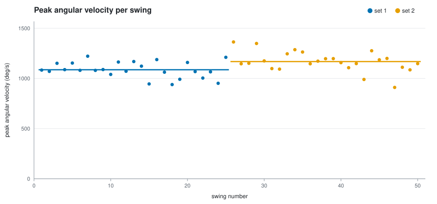
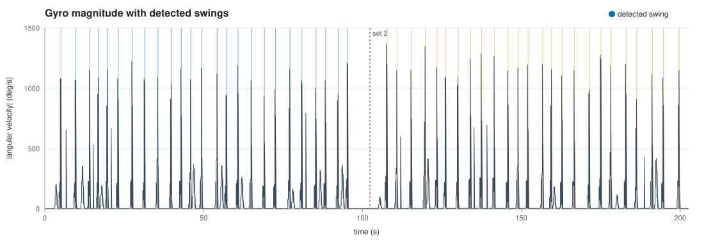

# Tennis Swing Tracker

An Arduino + MPU6050 motion sensor strapped to a racket or wrist that detects
every swing and reports **peak angular velocity, swing count and consistency**
per session and per set, so you can say things like *"set 2 was 7.5% faster than
set 1 (95% CI +2.9% to +12.1%)"*.

Everything is C++: the firmware runs on the Arduino, and a PC command-line tool
logs, analyses and plots sessions. Neither uses third-party libraries.





*(Charts from the bundled simulated demo session, see [Accuracy](#accuracy).)*

## What it does

- Reads the MPU6050 over **I2C** at **200 Hz** using a register-level driver
  written for this project (±2000 °/s gyro, ±16 g accel, 44 Hz on-chip low-pass
  filter). Gyro bias is calibrated at start-up, and calibration is rejected if
  the sensor moves.
- **Detects swings on the microcontroller** with a filtered, hysteresis-based
  state machine. It also classifies the rotation direction, which separates
  forehands from backhands.
- Streams raw samples and swing events over serial (USB, or a Bluetooth serial
  module such as an HC-05).
- The PC tool records sessions to CSV and reports:
  - swing count, swings/min and mean swing duration
  - peak angular velocity (mean, median, range)
  - **consistency** as the coefficient of variation (lower is more consistent)
  - **set-to-set change** with a Welch 95% confidence interval, so you can tell
    a real change from swing-to-swing noise
  - fatigue trend (% change per 10 swings)
  - SVG charts and an HTML report
- The same `SwingDetector.h` is compiled into the firmware *and* the PC tool, so
  thresholds can be re-tuned on logged data and the algorithm is unit-tested on
  a PC.

## Why angular velocity, not racket speed

Estimating true racket or ball speed from a cheap IMU means integrating
acceleration, and the error grows quickly (drift). This project deliberately
measures **peak angular velocity**, which the gyro reads directly, and compares
swings *relative to each other*. Comparisons like "faster than last set" are
reliable; "120 km/h" would not be.

## Hardware

| Part | Notes |
|---|---|
| Arduino Uno or Nano | any board with `Wire` should work |
| MPU6050 (GY-521 breakout) | ~£3 |
| Push button (optional) | marks the start of a new set |
| Battery pack + USB cable, or HC-05 Bluetooth module | for use on court |

| MPU6050 | Arduino Uno/Nano |
|---|---|
| VCC | 5V (GY-521 has a regulator) |
| GND | GND |
| SDA | A4 |
| SCL | A5 |

Button: pin 2 to GND (internal pull-up is used).

Mount the sensor firmly (tape or a 3D-printed clip on the racket throat, or a
wrist strap). Keep the same mounting between sessions: the numbers are relative.

## Getting started

### 1. Flash the firmware

Open `firmware/swing_tracker/swing_tracker.ino` in the Arduino IDE, select your
board and upload. Open the Serial Monitor at **115200 baud** to check that it
prints `# gyro bias dps: ...`. Keep the sensor still while it calibrates.

### 2. Build the PC tool

Needs CMake 3.16+ and a C++17 compiler (Visual Studio 2019+, GCC 9+ or Clang 10+).

```bash
cmake -S . -B build -DCMAKE_BUILD_TYPE=Release
cmake --build build --config Release
ctest --test-dir build -C Release --output-on-failure
```

On Windows with Visual Studio, run these from a "Developer PowerShell for VS".

### 3. Record a session

Close the Arduino Serial Monitor first (only one program can use the port).

```bash
build/swingtrack log --port COM5          # Windows
build/swingtrack log --port /dev/ttyUSB0  # Linux (macOS: /dev/cu.usbserial-*)
```

Each swing is printed as it happens. Type `n` + Enter (or press the button) at
the start of each new set, and `q` + Enter to stop. The session is saved to
`sessions/<date_time>/` with `raw.csv`, `swings.csv`, `markers.csv`,
`summary.txt`, `swings.svg`, `trace.svg` and `report.html`.

### 4. Analyse and re-tune

```bash
build/swingtrack analyze sessions/20261018_140501
build/swingtrack analyze sessions/20261018_140501 --redetect --min-peak 600
```

`--redetect` runs the detector again over the raw data on the PC. Use the
detector options to tune thresholds for your own swing:

| Option | Default | Meaning |
|---|---|---|
| `--start` | 300 °/s | filtered \|ω\| that opens a swing |
| `--end` | 150 °/s | \|ω\| below which a swing can end ... |
| `--hold` | 30 ms | ... if it stays there this long |
| `--min-peak` | 500 °/s | weaker motions are ignored |
| `--min-duration` | 60 ms | shorter spikes (knocks, impacts) are ignored |
| `--refractory` | 250 ms | dead time after a swing |

When you find better values, copy them into `DetectorConfig` in
`SwingDetector.h` and re-flash.

### No hardware yet? Use the simulator

```bash
build/swingtrack simulate examples/my_test --sets 3 --swings 30 --change 10
build/swingtrack analyze examples/my_test
build/swingtrack evaluate examples/my_test
```

## How swing detection works

```
|ω| = sqrt(gx² + gy² + gz²)  ->  low-pass filter (IIR, α = 0.5)

  IDLE ──(filtered |ω| > start)──► IN SWING  (track peak |ω|, peak |a|,
   ▲                                          integrated angle per axis)
   │                                   │
   │       filtered |ω| < end for `hold` ms
   │                                   ▼
   └──── accept if duration ≥ min-duration and peak ≥ min-peak,
         then wait `refractory` ms and for the signal to settle
```

- **Hysteresis** (start 300 / end 150) stops a single swing being split in two.
- **Minimum peak** rejects walking, bouncing the ball and racket twirls.
- **Minimum duration** rejects sharp knocks (tapping the racket on a shoe).
- **Re-arming** only after an accepted swing settles means a bounce-back is
  never counted as a second swing. A rejected candidate re-arms immediately: a
  hard swing's backswing can cross the start threshold on its own, and the real
  swing follows ~300 ms later.
- The axis with the largest integrated rotation, and its sign, gives the swing
  direction (e.g. `+Z` forehand, `-Z` backhand for a given mounting).

## Accuracy

### On simulated data (automated)

The simulator generates 200 Hz IMU data: backswing, forward swing and
follow-through, ball-impact shocks, gravity, centripetal acceleration, sensor
noise, slowly drifting gyro bias and ±2000 °/s clipping. It also adds
**non-swing movements that must be ignored** (slow movements up to 420 °/s and
sharp 900 °/s knocks). Results over 20 random sessions (1,800 swings, 893
distractors):

| Metric | Result |
|---|---|
| Swings detected (recall) | 1800 / 1800 |
| False detections | 0 |
| Peak angular velocity error | 0.1–0.3% mean absolute |
| Forehand/backhand direction | 100% correct |

The demo session was simulated with a true +8% change between sets; the tool
measured **+7.5%** (95% CI +2.9% to +12.1%).

Simulated data is cleaner than real tennis, so these numbers check that the
algorithm and code are correct. They are **not** a claim about real-world
accuracy.

### On real swings (to do on court)

1. **Count accuracy:** hit 50 shots while a friend counts (or film it), then run
   `swingtrack evaluate <session> --expected 50`. Repeat with shadow swings,
   serves and walking between points.
2. **Peak repeatability:** do 20 deliberately "same effort" swings and report
   the CV. That is the noise floor any set-to-set difference must beat.
3. **False positives:** record 5 minutes of walking, ball bouncing and picking
   up balls without swinging; the count should be 0.

Record your results here; a measured number is a better CV line than an
inflated one.

| Test | Result |
|---|---|
| Count error, 50 groundstrokes | _tbd_ |
| Count error, 20 serves | _tbd_ |
| False positives, 5 min no swings | _tbd_ |
| Peak CV, 20 same-effort swings | _tbd_ |

## Serial protocol

115200 baud, one message per line:

```
# <text>                                   info / status
R,t_ms,ax,ay,az,gx,gy,gz                   raw sample (g, °/s)
S,idx,set,t_start_ms,dur_ms,peak_dps,peak_g,axis   detected swing
M,set,t_ms                                 new set started
```

Commands sent to the board: `r` toggle raw stream, `n` next set,
`c` recalibrate, `z` reset, `?` status. With a low-bandwidth Bluetooth link,
`swingtrack log --no-raw` turns the raw stream off and keeps only swing events.

## Project layout

```
firmware/swing_tracker/
  swing_tracker.ino   sampling loop, serial protocol, button, LED
  MPU6050.h/.cpp      I2C register-level driver + gyro calibration
  SwingDetector.h     detection state machine (shared with the PC tool)
host/
  include/swingtrack/ headers
  src/
    main.cpp          CLI: log / analyze / simulate / evaluate
    logger.cpp        live serial capture
    serial_port.cpp   Win32 + POSIX serial port
    protocol.cpp      line parser
    analysis.cpp      detection on logs, statistics, confidence intervals
    report.cpp        report files
    svg_chart.cpp     dependency-free SVG charts
    simulator.cpp     synthetic IMU data + accuracy evaluation
tests/test_main.cpp   unit + end-to-end tests
examples/demo_session simulated session with report
```

CI builds and tests the PC tool on Windows, Linux and macOS, and compiles the
firmware for the Uno and Nano.

## Ideas for next steps

- ESP32 version with BLE and a phone dashboard
- Mount a second IMU and compare wrist vs racket
- Classify shot types (serve / groundstroke / volley) from the swing profile
- Real-world validation against high-speed video

## Licence

MIT
