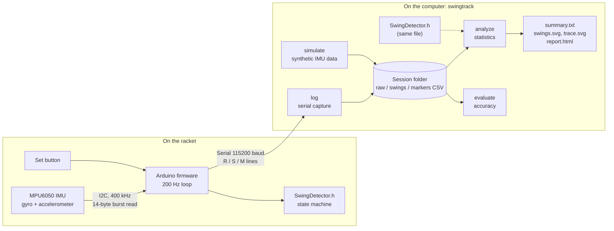
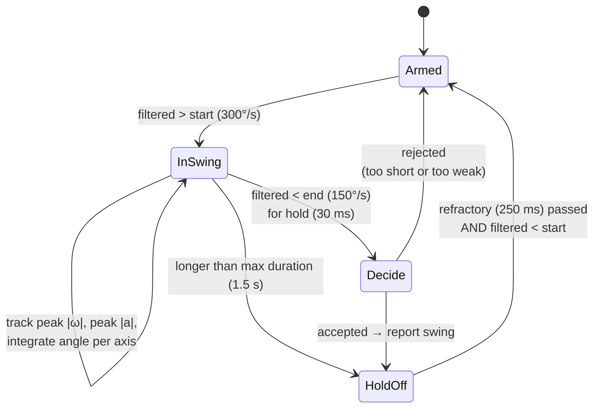

# Tennis Swing Tracker

[](https://github.com/FadersAX/tennis-swing-tracker/actions/workflows/ci.yml)


A wearable motion tracker for tennis. A small motion sensor (an **MPU6050 IMU**)
clips to the racket and is read by an **Arduino**, which spots every swing as it
happens. A **C++ desktop tool** then records the session and reports swing
speed, swing count, consistency and how performance changed from one set to the
next, with charts.

The aim is to answer questions like *"was I actually swinging faster in set 2,
or was that just normal variation?"* with real statistics, not guesswork:

```
set 1 -> set 2: +7.5%  (95% CI +2.9% to +12.1%, a real change)
```

Everything is written in C++ with **no third-party libraries**: the sensor
driver, the swing detector, the serial logger, the statistics and the chart
rendering.


*Both charts come from the bundled demo session in
[`examples/demo_session`](examples/demo_session), which was produced by the
simulator (see [Project status](#project-status)).*

---

## Contents

1. [Project status](#project-status)
2. [Features](#features)
3. [How it works](#how-it-works)
4. [Why angular velocity instead of racket speed](#why-angular-velocity-instead-of-racket-speed)
5. [Hardware](#hardware)
6. [Quick start](#quick-start)
7. [Command reference](#command-reference)
8. [Example output](#example-output)
9. [Firmware in detail](#firmware-in-detail)
10. [Swing detection algorithm](#swing-detection-algorithm)
11. [Statistics](#statistics)
12. [Serial protocol](#serial-protocol)
13. [Session file formats](#session-file-formats)
14. [The simulator](#the-simulator)
15. [Accuracy](#accuracy)
16. [Testing and CI](#testing-and-ci)
17. [Project layout](#project-layout)
18. [Design decisions](#design-decisions)
19. [Limitations](#limitations)
20. [Troubleshooting](#troubleshooting)
21. [Roadmap](#roadmap)
22. [Licence](#licence)

---

## Project status

| Part | Status |
|---|---|
| Firmware (sensor driver, swing detection, serial protocol) | Written; compiles for Arduino Uno and Nano in CI |
| Desktop tool (logging, analysis, reports) | Complete; built and tested on Windows, Linux and macOS in CI |
| Simulator and accuracy evaluation | Complete |
| Automated tests | 20 tests, all passing |
| **Physical hardware** | **Waiting on parts.** The device has not been assembled or tested on court yet |

All accuracy figures below come from **simulated sensor data**. Real-world
results will be added once the hardware is built (see
[Accuracy on real swings](#on-real-swings-planned)).

---

## Features

**On the device (Arduino firmware)**

- Register-level **I2C driver** for the MPU6050, written from the datasheet:
  ±2000 °/s gyro, ±16 g accelerometer, 44 Hz on-chip low-pass filter,
  **200 Hz** sampling.
- **Gyro calibration** at start-up that averages 400 readings and refuses to
  finish if the sensor is moved during calibration.
- **Real-time swing detection**: a filtered state machine with hysteresis that
  ignores walking, bouncing the ball and knocks.
- Records **peak angular velocity**, **peak acceleration**, **duration** and
  **direction** (forehand or backhand) for every swing.
- **Set marking** with an optional push button or a serial command.
- LED flash on every detected swing.
- Line-based **serial protocol** that works over USB or a Bluetooth serial
  module.

**On the computer (`swingtrack` command-line tool)**

- **Live logging** from the serial port to CSV, with each swing printed as it
  happens.
- **Session analysis**: swing count, swings per minute, average duration, peak
  speed statistics and **consistency** (coefficient of variation).
- **Set-to-set comparison** with a **95% confidence interval** (Welch's
  t-interval), so a real improvement can be told apart from noise.
- **Fatigue trend**: how much peak speed changed per 10 swings.
- **Re-detection**: re-run the exact firmware algorithm on recorded raw data
  with different thresholds, without re-flashing the board.
- **Reports**: plain-text summary, two SVG charts and an HTML page.
- **Simulator**: generates realistic 200 Hz sensor data with known "true"
  swings, so the whole pipeline can be developed and measured without hardware.
- **Accuracy evaluation**: precision, recall and peak-speed error against a
  ground truth.
- Cross-platform serial port code (**Win32** and **POSIX termios**).

---

## How it works



1. Every 5 ms the Arduino reads all six sensor values in one I2C transaction,
   converts them to g and °/s and subtracts the gyro bias found during
   calibration.
2. Each sample goes into the swing detector. When a swing finishes, the board
   sends a one-line summary of it (`S,...`).
3. If raw streaming is on, every sample is also sent (`R,...`), so the session
   can be re-analysed later.
4. On the computer, `swingtrack log` saves everything into a timestamped
   session folder. When you stop it, it writes the report.
5. `swingtrack analyze` can be run again at any time, optionally re-detecting
   swings with different thresholds.

The swing detector lives in a single header, `SwingDetector.h`, with no Arduino
or standard-library dependencies. **The exact same file is compiled into the
firmware and into the desktop tool**, so tuning and testing on a PC is testing
the code that runs on the device.

---

## Why angular velocity instead of racket speed

The obvious thing to measure is racket head speed in km/h. With a cheap IMU that
means integrating acceleration twice, after removing gravity, which requires
knowing the sensor's exact orientation at every instant. Small errors build up
very quickly (drift), so the result would look precise but not be trustworthy.

This project measures **peak angular velocity** instead: how fast the racket is
rotating, in degrees per second. The gyroscope measures this **directly**, with
no integration, so it does not drift within a swing. It is closely related to
racket speed (linear speed = angular speed × radius) and it is ideal for
**relative** comparisons:

- "My forehands were 7.5% faster in set 2" is reliable.
- "That forehand was 118 km/h" would not be, so the tool does not claim it.

---

## Hardware

### Parts

| Part | Notes | Approx. cost |
|---|---|---|
| Arduino Uno or Nano | any board supported by the `Wire` library should work | £5–£25 |
| MPU6050 breakout (GY-521) | 3-axis gyro + 3-axis accelerometer | £3 |
| Push button (optional) | marks the start of a new set | <£1 |
| Jumper wires | | £2 |
| Power for use on court | USB power bank, or a battery pack | £5–£10 |
| HC-05 Bluetooth module (optional) | wireless serial instead of a USB cable | £5 |
| Mount | tape, Velcro strap, or a 3D-printed clip for the racket throat | — |

### Wiring

| MPU6050 pin | Arduino Uno/Nano | Notes |
|---|---|---|
| VCC | 5V | the GY-521 board has its own 3.3 V regulator |
| GND | GND | |
| SDA | A4 | I2C data |
| SCL | A5 | I2C clock |
| AD0 | leave unconnected | I2C address 0x68 |
| INT | not used | the firmware polls instead |

Optional button: one leg to **pin 2**, the other to **GND**. The firmware enables
the internal pull-up resistor, so no extra resistor is needed.

### Mounting

- Fix the sensor **rigidly**. Any wobble shows up as noise and false peaks.
- Good places are the **racket throat** (between the handle and the head) or a
  tight **wrist strap**.
- Keep the **same position and orientation** between sessions. The numbers are
  designed for comparison, and moving the sensor changes them.
- Note which way the sensor faces. The detector reports direction as an axis and
  sign (e.g. `+Z`); with a fixed mounting, one sign is forehand and the other is
  backhand.

---

## Quick start

### 1. Build the desktop tool

Requirements: **CMake 3.16+** and a **C++17 compiler** (Visual Studio 2019+,
GCC 9+ or Clang 10+).

```bash
git clone https://github.com/FadersAX/tennis-swing-tracker.git
cd tennis-swing-tracker
cmake -S . -B build -DCMAKE_BUILD_TYPE=Release
cmake --build build --config Release
ctest --test-dir build -C Release --output-on-failure
```

On Windows, run these commands from a **Developer PowerShell for VS** so CMake
can find the compiler. The executable ends up in `build/` (or
`build/Release/` with the Visual Studio generator).

### 2. Try it without hardware

```bash
build/swingtrack simulate examples/my_test --sets 3 --swings 30 --change 10
build/swingtrack analyze examples/my_test
build/swingtrack evaluate examples/my_test
```

Open `examples/my_test/report.html` in a browser to see the charts.

### 3. Flash the firmware

1. Open `firmware/swing_tracker/swing_tracker.ino` in the **Arduino IDE**.
2. Select your board (e.g. *Arduino Uno*) and port.
3. Click **Upload**.
4. Open the **Serial Monitor** at **115200 baud**. Keep the sensor still; you
   should see:

   ```
   # tennis swing tracker v1.0
   # calibrating gyro - keep the sensor still
   # gyro bias dps: -1.23,0.45,0.08
   M,1,0
   R,4021,0.01,-0.02,1.00,0,1,-1
   ...
   ```

5. **Close the Serial Monitor** before using `swingtrack log`, as only one
   program can use the port at a time.

### 4. Record a session

```bash
build/swingtrack log --port COM5              # Windows
build/swingtrack log --port /dev/ttyUSB0      # Linux
build/swingtrack log --port /dev/cu.usbserial-1410   # macOS
```

While it runs, type a letter and press **Enter**:

| Key | Action |
|---|---|
| `n` | start the next set (same as pressing the button) |
| `c` | recalibrate the gyro (keep the sensor still) |
| `?` | print the board's status |
| `q` | stop, save and write the report (Ctrl+C also works) |

### 5. Analyse

```bash
build/swingtrack analyze sessions/20261026_140501
```

---

## Command reference

```
swingtrack log      --port PORT [--baud 115200] [--out sessions] [--no-raw]
swingtrack analyze  <session> [--redetect] [detector options]
swingtrack simulate <session> [--sets N] [--swings N] [--change PCT]
                    [--seed N] [--no-distractors]
swingtrack evaluate <session> [--expected N] [detector options]
```

### `log`: record from the board

| Option | Default | Description |
|---|---|---|
| `--port` | *(required)* | serial port, e.g. `COM5` or `/dev/ttyUSB0` |
| `--baud` | `115200` | must match the firmware |
| `--out` | `sessions` | parent folder; each session gets a `YYYYMMDD_HHMMSS` subfolder |
| `--no-raw` | off | turn off the raw sample stream and keep only swing events (for slow Bluetooth links) |

Opening the port resets an Uno (like the Arduino IDE does), so the board
recalibrates at the start of every session.

### `analyze`: statistics and report

Loads a session folder, prints the summary and writes `summary.txt`,
`swings.svg`, `trace.svg` (if raw data exists) and `report.html`.

| Option | Description |
|---|---|
| `--redetect` | ignore the swings the board reported and re-run the detector on `raw.csv` |
| detector options | see below; using any of them implies `--redetect` |

### `simulate`: make a synthetic session

| Option | Default | Description |
|---|---|---|
| `--sets` | `2` | number of sets |
| `--swings` | `25` | swings per set |
| `--change` | `8` | % change in average swing speed from each set to the next |
| `--seed` | `1` | random seed; the same seed always produces the same session |
| `--no-distractors` | off | leave out the non-swing movements |

Writes `raw.csv`, `markers.csv`, `swings.csv` (detected by the firmware
algorithm) and `truth.csv` (the swings that were actually simulated).

### `evaluate`: measure detection accuracy

- With a `truth.csv` in the session (from the simulator), it reports precision,
  recall, peak-speed error and forehand/backhand accuracy.
- With `--expected N` (the number of swings you counted by hand) it reports the
  count error. This is how real sessions will be checked.

### Detector options

Available on `analyze` and `evaluate`:

| Option | Default | Meaning |
|---|---|---|
| `--start` | 300 °/s | filtered rotation speed that opens a swing |
| `--end` | 150 °/s | a swing can end once the speed drops below this ... |
| `--hold` | 30 ms | ... and stays below it for this long |
| `--min-peak` | 500 °/s | candidates with a lower peak are ignored |
| `--min-duration` | 60 ms | shorter candidates (knocks, impacts) are ignored |
| `--refractory` | 250 ms | minimum gap after a swing before the next can start |

Once you find values that suit your swing, copy them into `DetectorConfig` in
[`SwingDetector.h`](firmware/swing_tracker/SwingDetector.h) and re-flash the
board.

---

## Example output

`swingtrack analyze examples/demo_session`:

```
Session summary
===============
Swings:            50 over 3.2 min
Peak ang. vel.:    mean 1127 dps, median 1146, range 910-1363
Consistency (CV):  8.7%  (lower = more consistent)
Trend:             +1.2% per 10 swings
Rotation axes:     +Z x37, -Z x13

Per set
-------
set  swings   mean dps       sd     CV %    dur ms  per min
1        25       1086       80      7.3       246     16.0
2        25       1168      100      8.5       247     15.7

Set-to-set change in mean peak angular velocity
-----------------------------------------------
set 1 -> set 2: +7.5%  (95% CI +2.9% to +12.1%, a real change)
```

`swingtrack evaluate examples/demo_session`:

```
Detection accuracy vs truth.csv
  true swings:      50
  detected:         50
  matched:          50
  precision:        100.0%  (detections that were real swings)
  recall:           100.0%  (real swings that were detected)
  peak error:       -0.11% mean, 0.18% mean absolute
  forehand/backhand 50/50 correct
```

Live output from `swingtrack log` looks like this:

```
--- set 1 ---
swing   1  set 1  peak   1083 dps   6.0 g  210 ms  +Z
swing   2  set 1  peak   1070 dps   5.6 g  270 ms  +Z
swing   3  set 1  peak   1151 dps   6.0 g  235 ms  +Z
```

---

## Firmware in detail

Source: [`firmware/swing_tracker/`](firmware/swing_tracker)

### Sensor configuration

The driver ([`MPU6050.cpp`](firmware/swing_tracker/MPU6050.cpp)) talks to the
chip directly through its registers instead of using a library:

| Register | Value | Effect |
|---|---|---|
| `WHO_AM_I` (0x75) | read | checks a sensor is present; accepts 0x68 (genuine) and 0x70 / 0x72 / 0x98 (common clones) |
| `PWR_MGMT_1` (0x6B) | `0x01` | wakes the chip and uses the gyro's PLL as a more stable clock |
| `CONFIG` (0x1A) | `0x03` | digital low-pass filter at ~44 Hz: removes vibration but keeps the swing shape |
| `SMPLRT_DIV` (0x19) | `4` | internal sample rate 1 kHz / (1 + 4) = **200 Hz** |
| `GYRO_CONFIG` (0x1B) | `0x18` | **±2000 °/s** full scale (16.4 LSB per °/s); fast swings exceed the smaller ranges |
| `ACCEL_CONFIG` (0x1C) | `0x18` | **±16 g** full scale (2048 LSB per g); ball impacts are sharp |

Readings are taken with a single **14-byte burst read** starting at
`ACCEL_XOUT_H` (accel X/Y/Z, temperature, gyro X/Y/Z), using an I2C repeated
start, so all six values come from the same instant. The bus runs at 400 kHz,
so a read takes well under a millisecond.

### Gyro calibration

A gyroscope reports a small non-zero value even when still (bias). At start-up
the firmware:

1. Takes 400 readings, 5 ms apart (about 2 seconds).
2. Tracks the minimum and maximum on each axis. If any axis varies by more than
   100 raw units (about 6 °/s), the sensor was moved, so it says so and tries
   again.
3. Stores the average as the bias and subtracts it from every later reading.

### Main loop timing

- Samples are scheduled with `micros()` every **5000 µs**. If the loop falls
  more than 4 periods behind (e.g. during a slow serial write), it resyncs
  instead of bursting through missed samples.
- Timestamps use `millis()`, which wraps after 49 days instead of 71 minutes.
- **Serial bandwidth budget:** a raw line is about 38 bytes. At 200 Hz that is
  about 7.6 kB/s, roughly 66% of a 115200-baud link, leaving room for swing
  events and status messages. Accel values are sent to 0.01 g and gyro values as
  whole °/s to keep lines short.
- The button is **debounced** (50 ms) and the swing LED is switched off without
  blocking the loop.

---

## Swing detection algorithm

Source: [`SwingDetector.h`](firmware/swing_tracker/SwingDetector.h)

### Signal

For each sample the detector computes the total rotation speed, independent of
how the sensor is mounted:

```
|ω| = √(gx² + gy² + gz²)
```

It then smooths it with a first-order low-pass (IIR) filter so single noisy
samples can't start or end a swing:

```
filtered = α·|ω| + (1 − α)·filtered_previous        α = 0.5
```

The filtered value decides *when* a swing starts and ends. The **unfiltered**
peak is what gets reported, so smoothing doesn't shave off the true peak.

### State machine



| Rule | Why it's there |
|---|---|
| **Hysteresis**: start at 300 °/s, end below 150 °/s | a single swing whose speed dips briefly isn't split in two |
| **Hold time**: must stay below 150 °/s for 30 ms | brief dips during a swing don't end it |
| **Minimum peak** 500 °/s | walking, bouncing the ball and twirling the racket are ignored |
| **Minimum duration** 60 ms | sharp knocks (e.g. tapping the racket on a shoe) are ignored |
| **Maximum duration** 1.5 s | long continuous motion isn't counted as one huge swing |
| **Refractory + re-arm**: after an accepted swing, wait 250 ms *and* for the speed to drop | the racket bouncing back after a shot isn't counted as a second swing |
| **Rejected candidates re-arm immediately** | on a hard swing, the backswing alone can pass 300 °/s. It is rejected as too weak, and the real swing ~300 ms later must still be caught |

The last rule came from testing: an earlier version started the refractory
period after *any* candidate. The simulator found a hard swing whose backswing
reached ~300 °/s, so the real forward swing was missed. There is now a
regression test for that case.

### Direction (forehand / backhand)

During a swing the detector integrates rotation on each axis separately
(angle += ω·Δt). The axis that turned the furthest is the main rotation axis,
and the sign shows the direction. With the sensor fixed in one orientation,
forehands and backhands rotate in opposite directions, so they come out as, for
example, `+Z` and `-Z`.

### Output per swing

| Field | Meaning |
|---|---|
| start time | when the filtered speed crossed the start threshold (ms) |
| duration | from start until the speed fell below the end threshold (ms) |
| peak angular velocity | highest unfiltered \|ω\| during the swing (°/s) |
| peak acceleration | highest \|a\| during the swing (g), including the ball impact |
| axis | main rotation axis and direction, e.g. `+Z` |

---

## Statistics

Source: [`analysis.cpp`](host/src/analysis.cpp)

### Per set and per session

| Statistic | How it's calculated |
|---|---|
| Mean, median, min, max | of peak angular velocity |
| Standard deviation | sample standard deviation (n − 1) |
| **Consistency** | coefficient of variation: CV = standard deviation ÷ mean × 100%. Lower means more consistent |
| Swings per minute | (swings − 1) ÷ time from first to last swing |
| Average duration and peak g | means over the set |

### Comparing sets

Swings naturally vary by several percent, so a difference between two set
averages could be real or could be chance. The tool reports a **95% confidence
interval** for the change using **Welch's t-interval**, which doesn't assume the
two sets are equally consistent:

```
difference  = mean₂ − mean₁
SE          = √(s₁²/n₁ + s₂²/n₂)
df          = (s₁²/n₁ + s₂²/n₂)² / [ (s₁²/n₁)²/(n₁−1) + (s₂²/n₂)²/(n₂−1) ]    (Welch–Satterthwaite)
95% CI      = difference ± t(0.975, df) × SE
```

The difference and both ends of the interval are shown as a percentage of the
first set's mean. If the interval doesn't include zero, the change is reported
as **"a real change"**; otherwise it's **"within noise"**. Critical values of t
come from a table for df = 1–30 (rounding df down, which is slightly
conservative) and 1.96 above that. At least two swings per set are needed.

### Trend

A least-squares straight line is fitted to peak speed against swing number. The
slope is reported as **% change per 10 swings**, a simple fatigue (or warm-up)
indicator.

---

## Serial protocol

115200 baud, 8N1, one message per line. The format is designed so a person can
read it in the Arduino Serial Monitor.

### Board to computer

| Line | Fields | Example |
|---|---|---|
| `# text` | info and status messages | `# gyro bias dps: -1.23,0.45,0.08` |
| `R,t,ax,ay,az,gx,gy,gz` | raw sample: time (ms), accel (g), gyro (°/s) | `R,15230,0.12,-0.98,0.05,12,-340,1500` |
| `S,idx,set,start,dur,peak_dps,peak_g,axis` | detected swing | `S,7,2,50000,180,1234.5,4.20,-Z` |
| `M,set,t` | a new set started at time t | `M,2,102338` |

### Computer to board

Single characters:

| Command | Effect |
|---|---|
| `r` | toggle the raw stream on/off |
| `n` | start the next set |
| `c` | recalibrate the gyro |
| `z` | reset the swing counter and set number |
| `?` | print status (set, swing count, raw on/off, I2C error count) |

The parser on the computer ([`protocol.cpp`](host/src/protocol.cpp)) checks
every field and rejects malformed lines, such as the partial line usually
received just after the port opens.

---

## Session file formats

Each session is a folder of plain CSV files that open in Excel, Python or any
spreadsheet program.

**`raw.csv`**: every sample (200 per second)

```csv
t_ms,ax,ay,az,gx,gy,gz
0,0.002,0.040,1.001,0.9,-0.4,-1.4
5,-0.019,0.040,0.993,1.0,-0.5,0.7
```

**`swings.csv`**: one row per detected swing

```csv
idx,set,t_start_ms,duration_ms,peak_dps,peak_g,axis
1,1,4995,210,1083.0,5.97,+Z
2,1,9645,270,1070.0,5.62,+Z
```

**`markers.csv`**: when each set started

```csv
set,t_ms
1,0
2,102338
```

**`truth.csv`**: simulator only, the swings that were really generated

```csv
set,t_peak_ms,peak_dps,axis
1,5068,1083.04,+Z
1,9740,1068.54,+Z
```

The analysis also writes **`summary.txt`**, **`swings.svg`**, **`trace.svg`** and
**`report.html`** into the same folder. The trace chart draws the minimum and
maximum of each pixel column, so peaks stay visible even for sessions with
hundreds of thousands of samples.

---

## The simulator

Source: [`simulator.cpp`](host/src/simulator.cpp)

Developing a detector needs data where the right answer is known. The simulator
generates 200 Hz sensor data and records the swings it generated in
`truth.csv`, so detection can be scored automatically.

### What each swing looks like

- **Backswing**: a slower rotation in the opposite direction (20% of the peak),
  about 320 ms before contact.
- **Forward swing**: a smooth pulse up to the peak speed (rise width 50–65 ms).
- **Follow-through**: a slightly slower decay than the rise (1.3× wider).
- **Rotation axis**: mainly one axis, with some rotation on the other two,
  because a wrist isn't a perfect hinge.
- **Ball impact**: a sharp 3–5 g shock in the accelerometer just after the peak.
- **Accelerometer**: gravity plus centripetal acceleration (ω² × r with
  r = 0.12 m), e.g. ~4.5 g at 1100 °/s.

### Session structure

| Setting | Default |
|---|---|
| Average peak speed in set 1 | 1100 °/s |
| Change in average between sets | +8% (set with `--change`) |
| Swing-to-swing variation | 7% standard deviation |
| Fatigue within a set | −4% from first to last swing |
| Share of backhands | 30% |
| Time between swings | 2.5–5 s (random) |
| Rest between sets | 8 s |

### Sensor imperfections

- Gyro noise: 0.7 °/s standard deviation per axis.
- Leftover gyro bias after calibration (about ±0.8 °/s) that **drifts** slowly
  as a random walk.
- Accelerometer noise: 0.02 g.
- Clipping at ±2000 °/s and ±16 g, like the real sensor.

### Distractors: movements that must be ignored

Between about half of the swings, the simulator adds a movement that is **not** a
swing:

- **Slow movements** (60% of distractors): walking, bouncing the ball or
  twirling the racket. Up to 420 °/s, so some cross the start threshold but
  never reach the minimum peak.
- **Sharp knocks** (40%): 400–900 °/s, but only about 15 ms long, plus an
  acceleration spike. They must fail the minimum-duration check.

The simulator uses a fixed random seed, so a given seed always produces exactly
the same session. That makes test failures reproducible.

---

## Accuracy

### On simulated data

Twenty simulated sessions, each with 3 sets × 30 swings (**1,800 swings** in
total, plus **893 non-swing distractors**), scored with `swingtrack evaluate`:

| Metric | Result |
|---|---|
| Swings detected (recall) | **1,800 / 1,800** |
| False detections | **0** |
| Peak angular velocity error | 0.1–0.3% mean absolute per session |
| Forehand/backhand direction | 100% correct |

In the demo session, the simulated change between sets was **+8%**. The tool
measured **+7.5%** with a 95% CI of +2.9% to +12.1%, which contains the true
value.

> **Important:** simulated data is much cleaner than real tennis. These results
> show that the algorithm and code are correct; they are **not** a claim about
> how accurate the device will be on court.

### On real swings (planned)

Once the hardware is built, these tests will measure real-world accuracy:

1. **Swing count:** hit 50 groundstrokes while someone counts (or film them),
   then run `swingtrack evaluate <session> --expected 50`. Repeat for serves and
   volleys.
2. **False positives:** record 5 minutes of walking, bouncing the ball and
   picking up balls without swinging. The count should be 0.
3. **Repeatability:** hit 20 swings at deliberately the same effort and report
   the CV. That is the noise floor any set-to-set difference has to beat.
4. **Thresholds:** use `analyze --redetect` with different detector options to
   tune for real swings, then update the firmware defaults.

| Test | Result |
|---|---|
| Count error, 50 groundstrokes | *pending hardware* |
| Count error, 20 serves | *pending hardware* |
| False positives, 5 min without swinging | *pending hardware* |
| Peak CV, 20 same-effort swings | *pending hardware* |

---

## Testing and CI

### Automated tests

[`tests/test_main.cpp`](tests/test_main.cpp) holds **20 tests** (81 checks)
using a small built-in test harness, so no test framework needs installing.

| Area | Tests |
|---|---|
| Swing detector | finds a single swing with the right peak, duration and direction; reports direction for both signs; rejects weak motion; rejects short knocks; separates consecutive swings; ignores a bounce-back inside the refractory window; keeps the real swing after a strong backswing (regression test); rejects over-long motion |
| Protocol | parses all four message types; rejects short, partial, non-numeric and invalid lines |
| Statistics | mean / median / standard deviation / CV against known values; detects a real 12% change; flags a noisy difference as not significant; trend slope; set assignment from markers; per-set grouping and the formatted report |
| Files and charts | session save/load round trip; tick spacing on chart axes |
| End to end | simulates 3 sets × 30 swings with distractors and requires ≥97% precision and recall, <2% peak error and every direction correct; checks the simulator is deterministic for a given seed |

Run them with:

```bash
ctest --test-dir build -C Release --output-on-failure
```

### Continuous integration

[GitHub Actions](.github/workflows/ci.yml) runs on every push:

- **Desktop tool**: configure, build and run all tests on **Windows**, **Linux**
  and **macOS**.
- **Firmware**: compile the sketch for **Arduino Uno** and **Arduino Nano**
  using `arduino/compile-sketches`.

Warnings are turned on (`/W4` on MSVC, `-Wall -Wextra -Wpedantic` on GCC and
Clang).

---

## Project layout

```
tennis-swing-tracker/
├── firmware/swing_tracker/        Arduino sketch
│   ├── swing_tracker.ino          200 Hz loop, serial protocol, button, LED
│   ├── MPU6050.h / .cpp           register-level I2C driver + gyro calibration
│   └── SwingDetector.h            swing detection state machine (also used by the PC tool)
├── host/                          desktop tool (swingtrack)
│   ├── include/swingtrack/        public headers
│   │   ├── types.h                RawSample, Swing, SetMarker, Session
│   │   ├── protocol.h             serial line parser
│   │   ├── serial_port.h          cross-platform serial port
│   │   ├── logger.h               live capture
│   │   ├── session_io.h           CSV read/write
│   │   ├── analysis.h             detection on logs, statistics
│   │   ├── report.h               report generation
│   │   ├── svg_chart.h            SVG chart writer
│   │   └── simulator.h            synthetic data + evaluation
│   └── src/                       implementations + main.cpp (command-line interface)
├── tests/test_main.cpp            unit and end-to-end tests
├── examples/demo_session/         simulated session with its full report
├── .github/workflows/ci.yml       CI: 3 operating systems + 2 Arduino boards
├── CMakeLists.txt                 build: swingcore library, swingtrack, swingtrack_tests
└── LICENSE                        MIT
```

The build creates a static library, `swingcore`, containing everything except
`main()`. Both the command-line tool and the test program link against it, so
the tests exercise the same code the tool runs.

---

## Design decisions

| Decision | Reason |
|---|---|
| **One detector file shared by firmware and PC** | The detector can be developed, tuned and unit-tested on a PC, and what's tested is exactly what runs on the board. It uses only `<math.h>` and `<stdint.h>` so it compiles for an 8-bit AVR. |
| **Detect on the device** as well as logging raw data | Swing events are tiny, so detection still works over a slow Bluetooth link with `--no-raw`. The raw stream allows re-analysis later. |
| **No libraries** for the sensor, charts or statistics | To understand each layer properly: registers and I2C transactions, SVG drawing, confidence intervals. It also means the project builds anywhere with just CMake and a compiler. |
| **Angular velocity, not speed in km/h** | Measured directly by the gyro, with no drift; good for honest relative comparisons. See [above](#why-angular-velocity-instead-of-racket-speed). |
| **Confidence intervals, not just averages** | A 3% difference between sets means nothing if swings naturally vary by 8%. The interval says whether a change is real. |
| **Plain CSV session files** | Easy to inspect, open in Excel or Python, and version-control. |
| **Simulator with ground truth** | Detection accuracy can be measured as a number, regression-tested in CI, and worked on before the hardware arrives. |
| **115200 baud** | Supported by every USB-serial chip and Bluetooth module, and reliable on a 16 MHz AVR; the raw stream fits within it with room to spare. |

---

## Limitations

- **Not yet tested on real hardware.** All results so far are from simulated
  data (see [Project status](#project-status)).
- **Relative, not absolute.** Angular velocity depends on where the sensor is
  mounted, so numbers are only comparable between sessions with the same
  mounting.
- **Forehand/backhand** comes from rotation direction. It assumes a fixed
  mounting, and serves or volleys may need their own rules.
- **Shot types aren't classified.** A serve, a groundstroke and a practice swing
  are all just "swings".
- **Thresholds are first guesses** based on typical swing speeds. They will need
  tuning with real data, which `analyze --redetect` is built for.
- A wired USB connection is impractical on court; a Bluetooth module or onboard
  storage is the realistic option.

---

## Troubleshooting

| Problem | Fix |
|---|---|
| `# MPU6050 not found - check wiring` repeats | Check SDA→A4, SCL→A5, VCC and GND. The address must be 0x68 (AD0 unconnected or to GND). |
| `# moved during calibration, retrying` | Put the sensor on a table and keep it still for 2 seconds. |
| `cannot open COM5` | Close the Arduino Serial Monitor (only one program can use the port), and check the port name in the IDE's *Tools → Port* menu. |
| Gibberish in the Serial Monitor | Set the baud rate to **115200**. |
| `unreadable lines` reported after logging | A few are normal right after connecting. Many suggest a loose cable or the wrong baud rate. |
| Too many swings detected | Raise `--min-peak` or `--start` with `analyze --redetect` to find better values. |
| Real swings missed | Lower `--min-peak` or `--start`; check the sensor is firmly attached. |
| Forehands and backhands look swapped | The sensor is mounted the other way round; the sign is relative to the mounting. |
| CMake can't find a compiler on Windows | Use the *Developer PowerShell for VS*, or open the folder in Visual Studio, which has CMake built in. |

---

## Roadmap

- [x] Firmware: sensor driver, calibration, swing detection, serial protocol
- [x] Desktop tool: logging, statistics, reports
- [x] Simulator, accuracy evaluation and automated tests
- [x] CI on Windows, Linux, macOS, Uno and Nano
- [ ] **Assemble the hardware** (waiting on parts)
- [ ] Measure real-world accuracy and fill in the results table
- [ ] Tune the detector thresholds on real swings
- [ ] Wireless: Bluetooth module, or an **ESP32** with BLE and a phone dashboard
- [ ] Classify shot types (serve, groundstroke, volley) from the swing shape
- [ ] Compare a wrist-mounted and a racket-mounted sensor
- [ ] Check peak speed against high-speed video

---

## Licence

[MIT](LICENSE) © 2026 Sufyan
